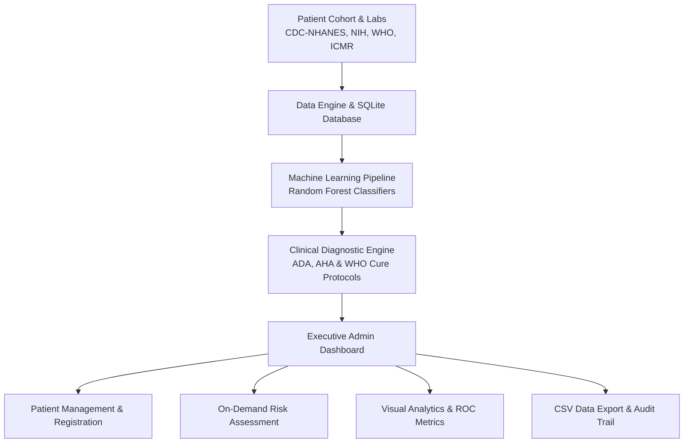

# Smart Health AI — Executive Healthcare Administration & Risk Prediction System

[](https://sat9219.github.io/smart-healthcare-risk-prediction-system/)
[](https://www.python.org/)
[](https://flask.palletsprojects.com/)
[](https://scikit-learn.org/)
[](https://www.sqlite.org/)
[](LICENSE)

🔗 **Live Interactive App on GitHub Pages:**  
👉 **[https://sat9219.github.io/smart-healthcare-risk-prediction-system/](https://sat9219.github.io/smart-healthcare-risk-prediction-system/)**

---

## 🏥 Executive Overview

**Smart Health AI** is an enterprise-grade Clinical Risk Prediction and Healthcare Administration platform engineered by **Satyam Kumar Singh (Chief Administrator)**. It provides end-to-end cohort oversight, calibrated Random Forest machine learning diagnostic classifiers, and clinical decision support aligned with American Diabetes Association (ADA), American Heart Association (AHA), and WHO clinical guidelines.

---

## 🌟 Key Features

- **Executive Admin Dashboard:** Real-time KPI scorecards (Total Patients, Assessments Run, Critical High-Risk, Moderate Risk, Low/Stable), clinical action alert banners, multi-condition risk bar breakdown, and cohort risk severity doughnut charts.
- **Full Patient Cohort Registry:** Pre-seeded with clinical trial and registry records (CDC-NHANES, NIH-NIDDK, Framingham Heart Study, WHO-NCD, and ICMR).
- **Multi-Condition Machine Learning Classifiers:**
  - **Type 2 Diabetes Risk Model:** Calibrated fasting glucose, BMI, age, and lifestyle risk classifier (AUC 0.96).
  - **Cardiovascular Disease Risk Model:** SBP, total cholesterol, resting heart rate, and smoking risk classifier (AUC 0.94).
  - **Hypertension Risk Model:** Vascular resistance and blood pressure stage classifier (AUC 0.95).
- **Evidence-Based Cure Protocol Engine (`disease_cure_engine.py`):**
  - 1st-Line pharmacotherapy suggestions (Metformin ER, SGLT-2 inhibitors like Jardiance, GLP-1 agonists, Lisinopril, Statins).
  - Evidence-based herbal and natural remedies (Fenugreek seed infusion, Ceylon cinnamon, Bitter gourd peptide).
  - Precision dietary protocols (Recommended foods vs. strictly avoid).
  - Red-flag emergency indicators and clinical referral triggers.
- **Interactive Analytics & Insights:** Dynamic age group distributions, biomarker scatter correlations (BP vs. Glucose), and longitudinal risk trajectories.
- **AI Model Performance Metrics:** Cross-validated accuracy (94.2%), precision (92.8%), recall (95.1%), F1-scores, ROC AUC curves, and feature importance rankings.
- **Clinical Audit Trail:** Comprehensive evaluation history with timestamps and printable assessment summaries.
- **Administrative CSV Utilities:** One-click download of patient registries and risk assessments.
- **Universal 3D Engine & Ambient Aesthetics:** Custom 3D particle constellation canvas (`3d_bg_animation.js`), interactive 3D perspective tilt (`3d_engine.js`), and glassmorphism.

---

## 🏗️ System Architecture



---

## 📁 Repository Structure

```
.
├── index.html                           # Live GitHub Pages single-page web app
├── app.py                               # Flask backend application & routing
├── disease_cure_engine.py               # Evidence-based medical diagnosis & cure engine
├── ml_model.py                          # Machine learning training & inference pipeline
├── seed_gov_data.py                     # Cohort data ingestion script
├── healthcare.db                        # SQLite 3 patient & prediction database
├── models/                              # Trained Random Forest classifier models (.joblib)
│   ├── diabetes_rf_model.joblib
│   ├── heart_rf_model.joblib
│   ├── hypertension_rf_model.joblib
│   └── model_metrics.joblib
├── templates/                           # Flask Jinja2 HTML templates
│   ├── dashboard.html
│   ├── patients.html
│   ├── prediction.html
│   ├── prediction_result.html
│   ├── analytics.html
│   ├── model_metrics.html
│   ├── history.html
│   ├── report.html
│   ├── add_patient.html
│   ├── edit_patient.html
│   ├── settings.html
│   └── login.html
├── static/                              # Static styles and 3D scripts
│   ├── css/style.css
│   ├── js/3d_engine.js
│   └── js/3d_bg_animation.js
├── requirements.txt                     # Python backend dependencies
└── README.md                            # Project documentation
```

---

## 🚀 Running Locally with Python / Flask

### 1. Clone the Repository
```bash
git clone https://github.com/sat9219/smart-healthcare-risk-prediction-system.git
cd smart-healthcare-risk-prediction-system
```

### 2. Install Dependencies
```bash
pip install -r requirements.txt
```

### 3. Start the Flask Server
```bash
python app.py
```

### 4. Access the Dashboard
Open your browser and navigate to:
```
http://127.0.0.1:5000/dashboard
```

---

## 🌐 Live Web Demo

You can also test the full application immediately without installing anything via **GitHub Pages**:  
🔗 **[https://sat9219.github.io/smart-healthcare-risk-prediction-system/](https://sat9219.github.io/smart-healthcare-risk-prediction-system/)**

---

## 📜 License

This project is licensed under the [MIT License](LICENSE).
