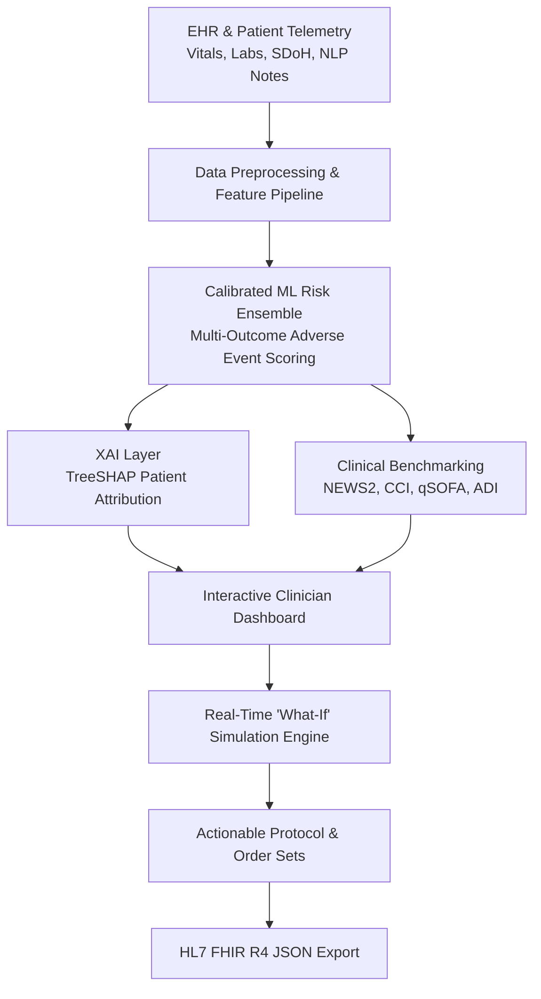

# AegisCare AI - Smart Healthcare Risk Prediction & Clinical Decision Support System (CDSS)

[](LICENSE)
[](https://www.python.org/)
[](https://hl7.org/fhir/)
[](https://github.com/slundberg/shap)

AegisCare AI is an end-to-end, production-grade **Clinical Decision Support System (CDSS)** engineered to bridge the gap between machine learning risk scoring and bedside clinician workflows. It features multi-outcome adverse event prediction, patient-specific **TreeSHAP explainability**, longitudinal biomarker tracking, and an interactive **"What-If" Intervention Simulator**.

---

## Key Features

- **Multi-Outcome Risk Engine:** Predicts calibrated probabilities for **30-Day Hospital Readmission**, **In-Hospital Deterioration**, and **Major Adverse Cardiac Events (MACE)**.
- **Explainable AI (TreeSHAP):** Transparent, patient-level feature attribution showing exactly *why* a patient is flagged (e.g., elevated Troponin I, reduced eGFR, high Systolic BP).
- **Interactive "What-If" Intervention Simulator:** Allows clinicians to dynamically adjust clinical levers (target BP, renal function, guideline-directed medical therapy, remote monitoring) and preview real-time risk reduction.
- **Evidence-Based Clinical Benchmarks:** Integrates standard validated scores including **NEWS2 (National Early Warning Score)**, **Charlson Comorbidity Index (CCI)**, and **qSOFA Sepsis Screening**.
- **Social Determinants of Health (SDoH):** Incorporates the **Area Deprivation Index (ADI)**, transportation access, and medication cost distress into risk stratification.
- **HL7 FHIR R4 Interoperability:** Generates standardized FHIR JSON `Bundle`, `RiskAssessment`, and `Observation` resources compatible with hospital EHRs (Epic, Cerner).
- **Custom Patient Assessment:** On-demand inference modal for entering new patient telemetry and running instant machine learning risk evaluation.

---

## System Architecture



---

## Project Structure

```
.
├── index.html           # Main Clinician CDSS Dashboard UI
├── styles.css           # Glassmorphic dark-theme clinical design system
├── app.js               # Clinical state machine, ML inference, and FHIR generator
├── model_pipeline.py    # Python Machine Learning pipeline & synthetic cohort generator
├── .gitignore           # Git ignore patterns
└── README.md            # Comprehensive project documentation
```

---

## Quick Start

### 1. Launch the Interactive Web Dashboard
You can run any local static file server:

```powershell
# Using Python
python -m http.server 3000

# Using Node.js
npx serve .
```
Then navigate to: **`http://localhost:3000/index.html`**

### 2. Run the Machine Learning Pipeline
```powershell
python model_pipeline.py
```

---

## Clinical Safety & Disclaimer
*AegisCare AI is designed as a Clinical Decision Support System (CDSS) for research and investigational decision augmentation. Final medical decisions should always be made by qualified healthcare professionals.*

---

## License
Distributed under the MIT License.
