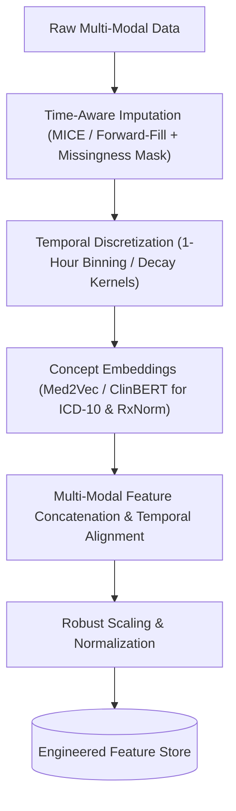
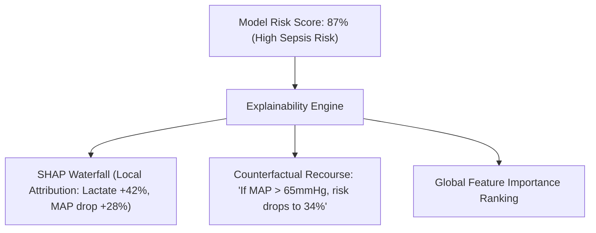
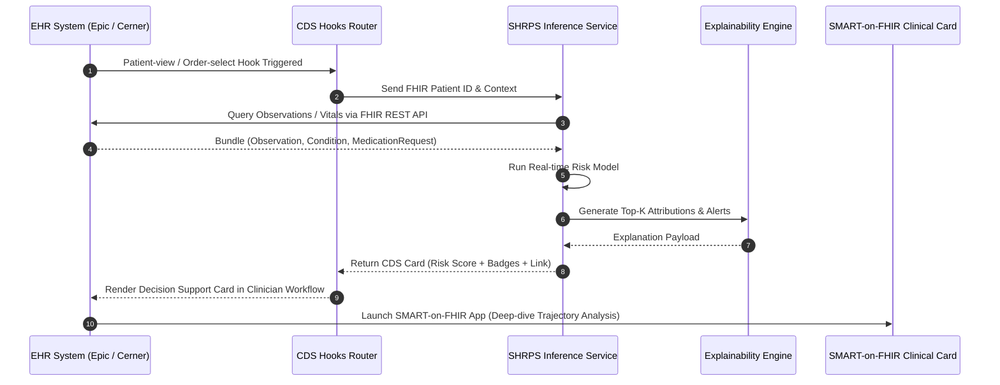
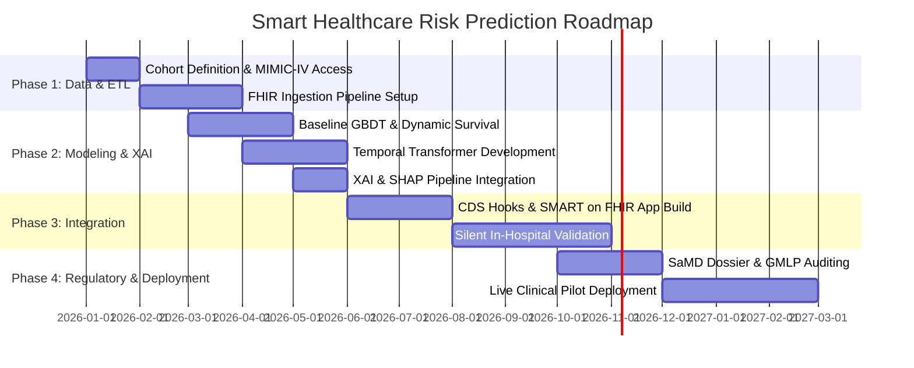

# Comprehensive Research Report: Smart Healthcare Risk Prediction System

## 1. Executive Summary & Clinical Problem Formulation

Modern healthcare systems generate vast volumes of heterogeneous patient data across Electronic Health Records (EHRs), continuous physiological monitoring, laboratory investigations, genomics, and IoT wearables. Despite this data richness, clinical decision-making often remains reactive rather than proactive. 

A **Smart Healthcare Risk Prediction System (SHRPS)** is an AI/ML-driven clinical decision support system (CDSS) engineered to forecast adverse clinical outcomes, disease trajectories, and patient decompensation prior to acute manifestation.


### Core Clinical Objectives
- **Early Intervention Window:** Detect deterioration (e.g., septic shock, cardiac arrest) 4–12 hours before clinical onset.
- **Resource Optimization:** Stratify ICU/inpatient admission risks to optimize bed allocation and staffing.
- **Reduction of False Alarm Fatigue:** Maintain high specificity (>85%) while achieving sensitive hazard detection (>90%).
- **Explainability & Trust:** Provide actionable biomarker attributions directly aligned with clinical reasoning.

---

## 2. Target Risk Prediction Domains

| Clinical Domain | Target Prediction Endpoint | Critical Prediction Horizon | Benchmark Target Metrics |
| :--- | :--- | :--- | :--- |
| **Sepsis Prediction** | Sepsis-3 onset (organ dysfunction + infection) | 4–6 hours prior to onset | AUROC > 0.88, AUPRC > 0.40 |
| **Cardiovascular Risk** | Major Adverse Cardiac Events (MACE), Heart Failure readmission | 30-day readmission & 10-year Framingham/ASCVD equivalent | C-Index > 0.82, Brier Score < 0.10 |
| **ICU Decompensation & Mortality** | Acute respiratory failure, vasopressor requirement, 48h mortality | 6–24 hours | AUROC > 0.90, Specificity @ 90% Sens > 0.80 |
| **Chronic Disease Progression** | Diabetic Nephropathy / Retinopathy, CKD Stage Progression | 1–5 years | Concordance Index > 0.85 |
| **Hospital Readmission** | 30-Day Unplanned All-Cause Readmission | At discharge planning | AUROC > 0.78, Net Benefit in Decision Curve Analysis |

---

## 3. Data Modalities & Benchmark Datasets

```
Heterogeneous Clinical Data
 ├── Static Tabular (Demographics, Medical History, Comorbidities, ICD-10/11)
 ├── Irregular Time-Series (Continuous Vitals: HR, SpO2, MAP, Temp, RR)
 ├── Discrete Event Streams (Medication administration, Lab test panels, Procedures)
 ├── Unstructured Clinical Notes (Discharge summaries, Radiology reports, Nurse notes)
 └── High-Dimensional Omics/Imaging (Genomic variants, 12-lead ECG waveforms, Chest X-rays)
```

### Primary Research Benchmark Datasets

1. **MIMIC-IV (v2.2+) & MIMIC-CXR:**
   - *Source:* PhysioNet / Beth Israel Deaconess Medical Center.
   - *Contents:* ~300,000 patient encounters, high-frequency vital signs, medications, laboratory results, and chest radiography.
2. **eICU Collaborative Research Database:**
   - *Source:* Philips Healthcare multi-center ICU registry.
   - *Contents:* >200,000 ICU admissions across 200+ hospitals across the US, ideal for validating multi-center domain adaptation.
3. **UK Biobank:**
   - *Contents:* 500,000 individuals with rich phenotypic, genomic, lifestyle, and multi-organ imaging data for longitudinal risk prediction.
4. **PhysioNet/CinC Sepsis Challenge Dataset:**
   - *Contents:* Hourly vitals and lab panels specifically labeled for early sepsis detection protocols.

---

## 4. Preprocessing & Temporal Feature Engineering Pipeline

Healthcare time-series data presents unique challenges: severe sparsity, irregular sampling intervals, missing-not-at-random (MNAR) observations, and label imbalance.



### Key Methodologies
1. **Handling Missingness:**
   - *Forward-Fill with Decay:* Propagate the last observed value with exponential decay towards population mean over time $\Delta t$:
     $$x^*(t) = x(t_{\text{last}}) \cdot e^{-\gamma \Delta t} + \mu \cdot (1 - e^{-\gamma \Delta t})$$
   - *Missingness Indicator Binary Masks:* Explicitly feed 0/1 indicator vectors into models (the act of ordering a test is itself a strong prognostic signal).
2. **Clinical Concept Embeddings:**
   - Use pre-trained medical graph embeddings (e.g., SNOMED-CT, Med2Vec) to capture semantic proximity between related diseases (e.g., Atherosclerosis and Peripheral Vascular Disease).
3. **Dynamic Waveform Summarization:**
   - Extract spectral power, heart rate variability (HRV - SDNN, RMSSD), and rolling window statistics (mean, variance, skewness, min/max slope over 1h, 6h, 24h).

---

## 5. Model Architectures & Algorithmic Paradigms

```
Algorithmic Hierarchy
 ├── Baseline Interpretable Models (Logistic Regression, ElasticNet, Generalized Additive Models - EBMs)
 ├── Gradient Boosted Decision Trees (XGBoost, LightGBM, CatBoost)
 ├── Recurrent & Sequence Models (BiLSTM, GRU with Decay - GRU-D)
 ├── Attention-Based Transformers (Temporal Fusion Transformer, Med-BERT, BEHRT)
 └── Multi-Modal Foundation Models (Clinical Foundation Models, Waveform-Text Cross-Attention)
```

### 1. Gradient Boosted Decision Trees (LightGBM / CatBoost / XGBoost)
- **Strengths:** Dominates static tabular data and snapshot risk scoring (e.g., 30-day readmission at discharge).
- **Optimization:** Tree-SHAP integration provides exact, fast local feature attribution.
- **Handling Categoricals:** CatBoost directly handles high-cardinality ICD/CPT codes without one-hot explosion.

### 2. Time-Aware Recurrent Networks (GRU-D / Phased LSTM)
- **Strengths:** Models irregular sampling intervals and physiological trajectory trends.
- **GRU-D Formulation:** Incorporates learnable decay rates on both input features and hidden states to model elapsed time between observations.

### 3. Temporal Fusion Transformers (TFT) & Foundation Models
- **Architecture:** Combines multi-head self-attention with gated residual networks to learn long-range temporal dependencies across multivariable vital streams while retaining interpretability through self-attention weights.

### 4. Survival Analysis Models (Hazard Modeling)
- **DeepSurv / Dynamic DeepHit:** Models time-to-event curves subject to right-censoring, predicting not just *if* an adverse event will occur, but *when* (survival probability distribution $S(t|x)$).

---

## 6. Explainable AI (XAI) & Clinical Interpretability

Black-box predictions are unacceptable in regulated clinical settings. Clinicians require transparent, biologically plausible rationale.



### Interpretability Suite
1. **SHAP (Shapley Additive exPlanations):**
   - Game-theoretic formulation allocating fair contribution of each vital/lab to the final risk score.
2. **Counterfactual Explanations:**
   - Identifies minimum clinical biomarker changes required to transition a patient from high-risk to safe thresholds.
3. **Clinician-Friendly Visualizations:**
   - Biomarker trajectory overlays showing current trends against normative physiological bands.

---

## 7. Clinical Integration & Interoperability Architecture

A risk prediction system must seamlessly integrate into clinical workflows without requiring separate logins or manual data re-entry.



### Standards & Protocols
- **HL7 FHIR (Fast Healthcare Interoperability Resources - R4 / R5):** Standard data interchange format using JSON REST APIs.
- **SMART on FHIR:** OAuth2/OpenID Connect framework allowing plug-and-play UI apps embedded directly in Epic Hyperspace, Cerner Millennium, or web portals.
- **CDS Hooks:** Event-driven triggers (e.g., `patient-view`, `order-sign`) invoked during physician chart review.

---

## 8. Ethical, Regulatory & Safety Guidelines

### 1. Regulatory Categorization (FDA SaMD & EU MDR)
- Classified as **Software as a Medical Device (SaMD)** under IMDRF Risk Categorization (Class IIa / Class IIb depending on severity of clinical action).
- Adheres to FDA's **Good Machine Learning Practice (GMLP)** and Predetermined Change Control Plans (PCCP).

### 2. Bias Mitigation & Subgroup Fairness
- **Demographic Parity & Equalized Odds:** Verify model calibration across disparate demographic groups (age, biological sex, race/ethnicity, socioeconomic deciles).
- **Intersectional Auditing:** Ensure worst-case subgroup performance meets the non-inferiority bound.

### 3. Continuous Drift Monitoring
- **Data Drift:** KS-test and Population Stability Index (PSI) on incoming lab/vital distributions.
- **Concept Drift:** Degradation in calibration curves over time due to changing hospital protocols or antibiotic formularies.

---

## 9. End-to-End Technical Architecture

```
Layer 1: Ingestion & Streaming
  ├── Kafka / AWS Kinesis (Real-time telemetry & vital monitors)
  └── FHIR Subscription Endpoints (EHR encounter updates)

Layer 2: Storage & Feature Store
  ├── InfluxDB / TimescaleDB (Time-series vitals)
  ├── PostgreSQL / MongoDB (Demographics & metadata)
  └── Feast / Hopsworks (Feature Store for real-time model feature serving)

Layer 3: Model Serving & Orchestration
  ├── FastAPI / Triton Inference Server (Sub-50ms inference latency)
  ├── PyTorch / ONNX Runtime (Optimized model execution)
  └── Celery / Redis (Asynchronous background risk computations)

Layer 4: Interoperability & UI
  ├── CDS Hooks Service (JSON API complying with CDS Hooks Spec 1.0)
  └── Next.js / React SMART on FHIR Web Application (Interactive trajectories & SHAP waterfalls)
```

---

## 10. Practical Step-by-Step Implementation Roadmap



### Key Milestones
1. **Phase 1 (Data Foundation):** Establish HIPAA-compliant data pipeline, harmonize data into OMOP CDM / FHIR format, build missingness-robust pipelines.
2. **Phase 2 (Model Development):** Train ensemble models (LightGBM + Temporal Transformer), validate on cross-center cohorts (MIMIC-IV to eICU), achieve target AUROC/calibration.
3. **Phase 3 (Clinical Integration):** Implement SMART-on-FHIR dashboard and CDS Hooks; conduct silent mode trial (shadow deployment without alerting).
4. **Phase 4 (Prospective Clinical Evaluation):** Measure clinical impact via prospective randomized or quasi-experimental study (time to intervention, ICU transfer rates, mortality reduction).
